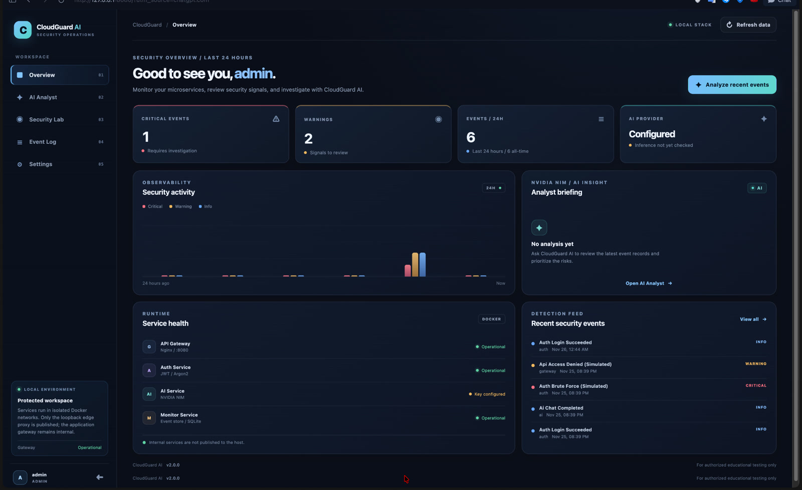
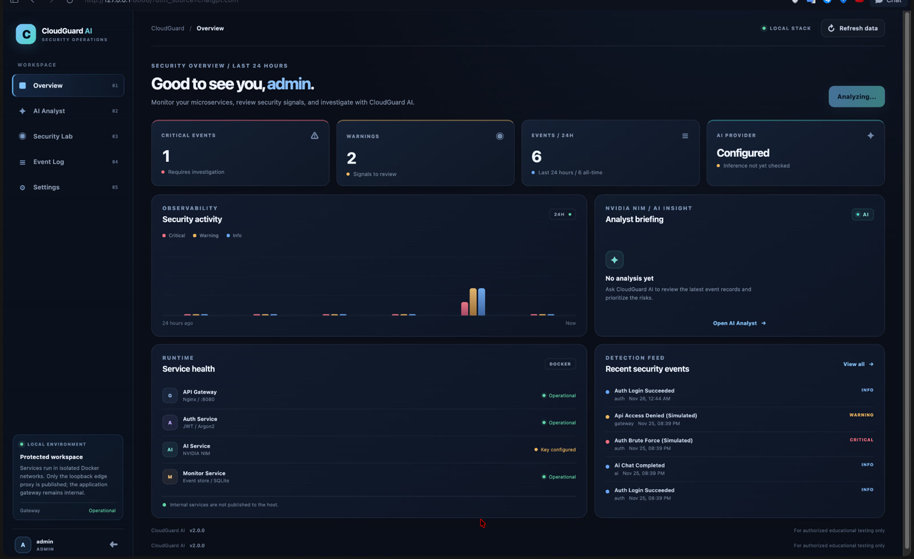
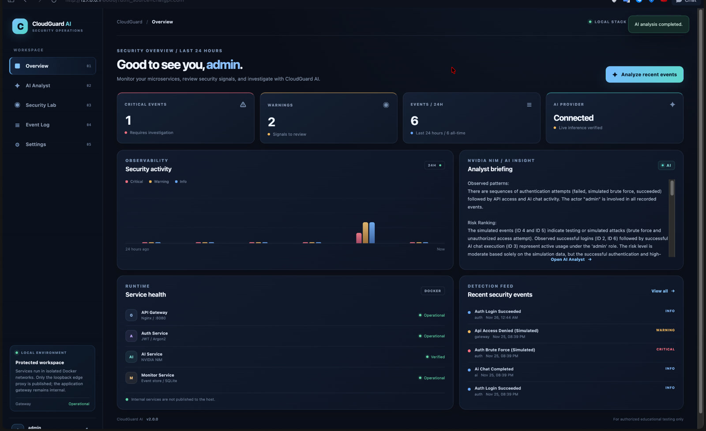
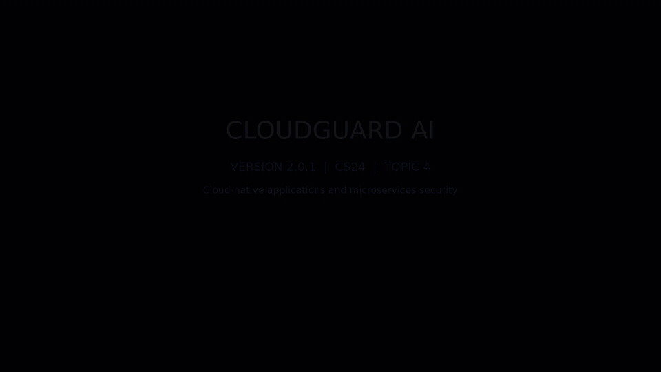

# CloudGuard AI 2.0.1

**Course:** 1400002063 - Cyber Security
**Group:** CS24
**Assigned topic:** Topic 4 - Security of Cloud-Native Applications and Microservices
**Project type:** Local Docker-based educational security platform

CloudGuard AI is a local security operations workspace that demonstrates how a cloud-native microservices application can authenticate users, isolate services, collect security events, assess container images, and use an AI analyst to explain security evidence. The original Flask/Nginx/NVIDIA prototype has been evolved into a Docker Compose application with FastAPI services, a persistent web interface, safe lab simulations, real Trivy image scanning, and a security regression suite.

The project is intended for an authorized university demonstration. It is not a production SOC, a penetration-testing certification, or an automated remediation system.

## 1. Capabilities

- Responsive security dashboard with 24-hour event metrics, service health, recent activity, and an AI briefing.
- NVIDIA NIM chat using the OpenAI-compatible Chat Completions API. The API key remains on the backend.
- Persistent, per-user AI conversation history stored in local SQLite.
- AI event triage using structured monitor events and saved Trivy scan reports.
- Authentication service with Argon2 password hashing, signed JWTs, HttpOnly/SameSite cookies, and self-service password changes.
- Dedicated loopback-only Nginx edge proxy in front of an internal Nginx application gateway; the application gateway applies request throttling and security response headers.
- Monitoring service with persistent SQLite event, scan-report, and assessment-report stores.
- Safe synthetic lab scenarios for brute-force patterns, unauthorized API access, container findings, prompt-injection signals, and rate-limit events.
- Real local Docker image scanning through Trivy. The scanner receives a read-only exported image archive; it is not given the Docker socket.
- Authenticated security regression script that tests the running application and saves a result summary in the dashboard.
- Lightweight resilience check for service health, response latency, restart policies, health checks, and network exposure.
- Before/after control matrix mapped to the original insecure repository baseline.
- JSON security report export containing summary metrics, recent events, scan reports, assessment results, configured controls, and known limitations.
- Docker health checks, non-root application processes, read-only container root filesystems, dropped Linux capabilities, and isolated Docker networks.

## Visual evidence and demo

The screenshots below document the currently demonstrated Overview and AI event-triage flow. The demo video is a short, silent walkthrough assembled from these screenshots; it is not a live recording of every page.









<!-- GITHUB_INLINE_VIDEO_START -->
For inline playback, upload `docs/demo/cloudguard-ai-overview-demo.mp4` as a GitHub Markdown video attachment, then replace this note with the generated asset URL on its own line. See [demo media instructions](docs/demo/README.md).
<!-- GITHUB_INLINE_VIDEO_END -->

See [the implementation progress and validation record](docs/PROJECT_PROGRESS.md) for completed work, test evidence, limitations, and remaining tasks.

## 2. Architecture

```text
Browser
  |
  | http://127.0.0.1:8080
  v
Nginx Edge Proxy (only host-published service)
  |
  | internal frontend network
  v
Nginx Application Gateway (internal)
  |                 |                    |
  v                 v                    v
Auth Service       AI Service          Monitor Service
Argon2 + JWT       NVIDIA NIM          SQLite event store
                   SQLite chat store   Trivy / assessment reports
```

Docker networks:

- `host_ingress`: standard bridge network used only by the edge proxy so Docker can publish the loopback host port. The edge proxy has a fixed upstream and no user-controlled proxy destination.
- `frontend`: internal Docker network shared only by the edge proxy and application gateway.
- `backend`: internal Docker network shared by the application gateway and application services. It has no external route.
- `egress`: standard bridge network attached only to the AI service with explicit default-gateway priority so it can call the hosted NVIDIA endpoint. The Trivy scanner is a separate short-lived host-invoked container that needs registry/database egress.

The separate edge proxy is intentional: Docker Engine does not publish host ports for a container attached exclusively to `internal: true` bridge networks because those networks have no default gateway. Keeping the application gateway on internal networks while publishing a minimal edge proxy preserves backend isolation.

The host port mapping is `127.0.0.1:8080:8080` on the edge proxy. The application gateway, Auth, AI, and Monitor ports are not published to the host. Internal service-to-service event delivery uses a shared service token. The internal application gateway hides the monitor internal route prefix from browser clients, and the monitor service rejects internal requests without the token.

## 3. Requirements

- Docker Desktop / Docker Engine with `docker compose` support.
- Python 3.10+ for setup and local test/scanner scripts.
- Node.js is not required; the frontend is plain HTML, CSS, and JavaScript.
- An NVIDIA API key from NVIDIA Build for live AI inference.
- Internet access for NVIDIA inference and the first Trivy vulnerability database download.
- Port `8080` available on the host.

The application runs locally in Docker. NVIDIA inference is hosted, so a local NVIDIA GPU is not required. Trivy is run in a short-lived Docker container against locally exported image archives.

## 4. First-time installation

From the project root:

### Step 1 - Generate secrets

```bash
python3 scripts/setup.py
```

The script creates `.env` with a random JWT signing key, an internal service token, and a random first-run administrator password. It prints the administrator password once. Save it securely. The `.env` file is written with owner-only permissions where supported.

### Step 2 - Configure NVIDIA

Open `.env` and set:

```dotenv
NVIDIA_API_KEY=your_nvidia_api_key
NVIDIA_MODEL=nvidia/nemotron-3.5-bolt-e4b
NVIDIA_BASE_URL=https://integrate.api.nvidia.com/v1/chat/completions
```

The model is configurable. Use a model available to your NVIDIA account. Never put the API key in frontend files, screenshots, source control, or prompts.

### Step 3 - Build and start

```bash
docker compose up --build -d
```

Open [http://127.0.0.1:8080](http://127.0.0.1:8080). Sign in as `admin` with the password printed by the setup script.

### Step 4 - Verify the stack

```bash
docker compose ps
python3 scripts/doctor.py
sh scripts/run_unit_tests.sh
python3 tests/security_regression.py
python3 tests/resilience_test.py
```

The unit tests run in a dedicated Docker test image with network access disabled. They use isolated temporary SQLite databases and mock NVIDIA inference. They do not make live API calls or scan the user's Docker images.

## 5. Upgrade from CloudGuard AI 1.0

1. Keep a backup of the existing project folder.
2. Extract the 2.0.1 archive into a new folder, or replace the source files in the existing folder.
3. Copy the existing `.env` file into the 2.0 project root. Do not generate new secrets if you want to keep the existing administrator account.
4. From the 2.0 project root, run:

   ```bash
   docker compose up --build -d
   ```

The Compose project name is explicitly fixed as `cloudguard-ai`, so the existing `cloudguard-ai_auth_data` and `cloudguard-ai_monitor_data` volume names are retained even if the new folder has a version suffix. The new AI conversation volume is created automatically. Existing users and event records are preserved. **Do not run `docker compose down -v` during an upgrade**; that command deletes persistent volumes.

## 6. Using the application

- **Overview:** review 24-hour severity metrics, all-time event count, service health, recent events, and the AI briefing.
- **AI Analyst:** chat with NVIDIA NIM. Successful conversations are stored locally per username. Use **New chat** to clear the saved history for the current account.
- **Analyze latest events:** send recent structured events and recent Trivy scan summaries to NVIDIA for evidence-based triage. The AI response is advisory.
- **Security Lab:** generate labelled synthetic records. These simulations do not attack external systems and do not prove a control blocked a real attack.
- **Container security scans:** run the local Trivy script from the project root. Results are uploaded to the monitor database and shown in the Security Lab page.
- **Event Log:** inspect up to 100 most recent records and filter by severity. The dashboard metrics are explicitly limited to the last 24 hours; the Event Log can include older records.
- **Security Settings:** change the administrator password. Password changes invalidate the current browser session.
- **Download security report:** export a JSON evidence bundle from the Security Lab page.

## 7. Real container image scan

Start the stack first, then run:

```bash
python3 scripts/scan_local_images.py
```

The script prompts for the CloudGuard administrator password, exports the four local images with `docker image save`, and runs the pinned Trivy scanner image against each archive. It does **not** mount `/var/run/docker.sock` into the scanner. Trivy's vulnerability database may need to download on the first run. The script saves scan summaries, image IDs, scanner metadata, and up to 100 representative findings per image to CloudGuard's local monitor API. It also writes a redacted raw Trivy JSON report under `reports/trivy/`; matched secret values and source snippets are redacted before the file is saved.

Default images:

- `cloudguard-ai/gateway:local`
- `cloudguard-ai/auth:local`
- `cloudguard-ai/ai:local`
- `cloudguard-ai/monitor:local`

You can scan a subset or different local image tags:

```bash
python3 scripts/scan_local_images.py --images cloudguard-ai/auth:local,cloudguard-ai/ai:local
```

A scan is evidence about the image contents at the scan time. It is not a runtime exploitability test, and a clean result does not prove the application is secure. Review findings and rebuild images after dependency or base-image updates.

## 8. Original baseline build and before/after image comparison

The supplied original repository is retained under `baseline/` for static review and optional image scanning. These files intentionally contain insecure demo code. **Do not run the original services or restore the original Compose file.** The baseline build script only builds images; it does not start containers.

Build the original service images:

```bash
python3 scripts/build_baseline_images.py
```

Scan the baseline images with the same pinned Trivy version and settings used for the hardened images:

```bash
python3 scripts/scan_local_images.py --images cloudguard-baseline/auth:original,cloudguard-baseline/ai:original,cloudguard-baseline/logger:original,cloudguard-baseline/gateway:original
```

Then scan the hardened CloudGuard images with the default command:

```bash
python3 scripts/scan_local_images.py
```

The dashboard will contain both sets of reports. Compare only like-for-like image roles and retain image IDs, scan timestamps, scanner version, and the Trivy database state. The project does not invent baseline CVE counts. The original source-level weaknesses and their 2.0 controls are mapped in `docs/baseline-comparison.md`.

## 9. Security regression assessment

Run:

```bash
python3 tests/security_regression.py
```

The script prompts for the administrator password and checks gateway health, response headers, unauthenticated access denial, gateway hiding of internal service routes, CSRF request headers, session cookie flags, persistent AI history, dashboard metric consistency, scan/report endpoints, and event persistence after a safe simulation. Internal service-token enforcement is also covered by the isolated unit tests. It saves a structured assessment result to the dashboard.

For quick local checks:

```bash
python3 scripts/doctor.py
sh scripts/run_unit_tests.sh
python3 tests/security_regression.py
python3 tests/resilience_test.py
```

The unit suite does not replace the authenticated regression suite, the lightweight resilience check, or a live NVIDIA request. The resilience check sends a small number of health requests and does not stop containers or perform a stress test.

## 10. Data storage and privacy

Docker named volumes:

- `cloudguard-ai_auth_data`: account password hashes.
- `cloudguard-ai_ai_data`: AI conversation history, scoped by username.
- `cloudguard-ai_monitor_data`: security events, Trivy scan reports, and assessment reports.

NVIDIA receives the chat or analysis content sent to its hosted inference API. The application does not include passwords, JWTs, service tokens, or API keys in event records. Avoid entering real personal data, credentials, or confidential information in prompts.

To stop the application without deleting data:

```bash
docker compose down
```

To start it again:

```bash
docker compose up -d
```

To create consistent SQLite backups while the services are running:

```bash
python3 scripts/backup_data.py
```

Backups are written to a private `backups/` directory with restrictive file permissions. They are not encrypted and contain account hashes, local chat history, and security records; keep them private and do not commit them.

To permanently delete local user, chat, event, scan, and assessment data, use `docker compose down -v`. This is destructive and should only be done when you intentionally want a clean reset.

## 11. Security controls and limitations

Configured controls include Argon2 password hashing, signed JWT sessions, HttpOnly/SameSite cookies, same-origin checks on state-changing browser requests, Nginx request throttling, security response headers, internal service authentication, isolated Docker networks, non-root application processes, read-only root filesystems, and a restricted Trivy scanner container.

Known limitations:

- This is a local educational application, not a production-ready multi-tenant platform.
- The AI analyst can make mistakes and cannot enforce authorization or automatically remediate systems.
- Prompt-injection heuristics are signals, not a complete defense against prompt injection.
- The lab's attack buttons create synthetic records. They are not real attacks.
- Trivy scans image archives; it does not inspect live process behavior or prove runtime exploitability.
- The app does not currently deploy a Kubernetes cluster or a service mesh. The project demonstrates containerized microservices with Docker Compose.
- Hosted NVIDIA inference requires network access and may be subject to model availability, account limits, and service outages.
- The JSON report is an evidence bundle, not a compliance certification or independent penetration-test report.

## 12. Course alignment

CloudGuard AI demonstrates the security of cloud-native applications and microservices through service isolation, gateway protection, authentication, service-to-service authentication, container image assessment, event observability, and AI-assisted security triage. See `docs/architecture.md`, `docs/security-controls.md`, `docs/baseline-comparison.md`, and `docs/demo-script.md` for the explanation to use in the research report and presentation.
